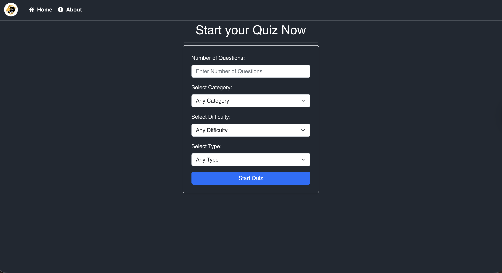
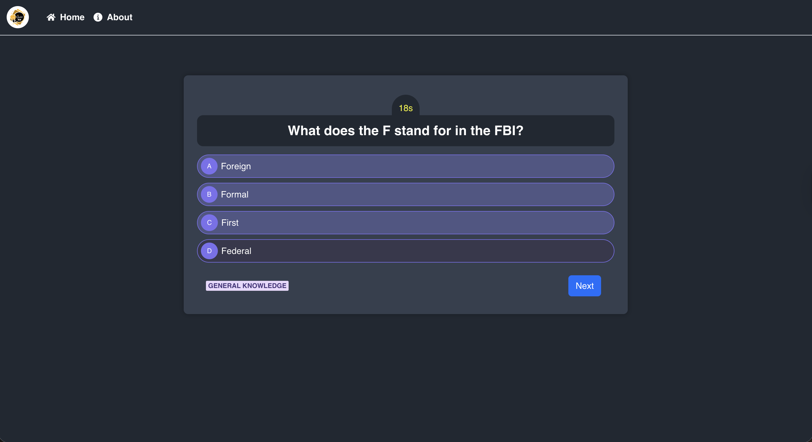
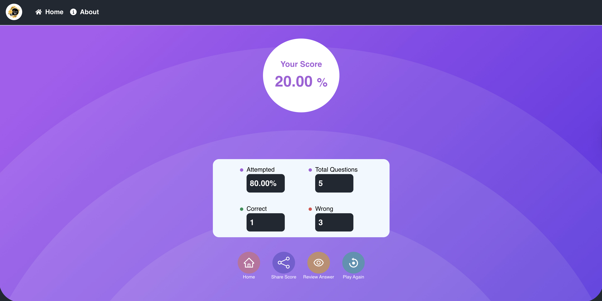
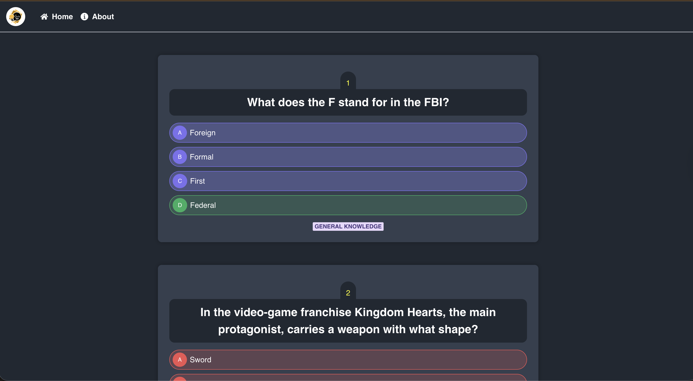

# 📝 Quiz App

A modern, high-performance Quiz Application built with **React** and **Vite**. This app provides a fast, responsive, and engaging user experience for testing knowledge across multiple topics.

[](https://quiz-app-tau-rose.vercel.app/)
[](https://vercel.com/)
[](https://reactjs.org/)

---

## 🚀 Live Preview
The app is automatically deployed and hosted on **Vercel**. 
**[View Live App →](https://quiz-app-tau-rose.vercel.app/)**

---

## ✨ Features
- **Fast Performance:** Built with Vite for lightning-fast hot module replacement (HMR).
- **Interactive Quiz Logic:** Real-time state management for handling questions, answers, and scoring.
- **Responsive Design:** Optimized for mobile, tablet, and desktop screens.
- **Clean UI:** Minimalist and intuitive interface for a better user experience.
- **Score Summary:** Detailed breakdown of results at the end of each session.

## 🛠️ Tech Stack
- **Library:** [React.js](https://reactjs.org/)
- **Build Tool:** [Vite](https://vitejs.dev/)
- **Deployment:** [Vercel](https://vercel.com/)
- **Icons/Styling:** CSS3 & Lucide-react (or standard React Icons)

## 📦 Installation & Local Development

To run this project locally, follow these steps:

1. **Clone the repository**
   
   ```bash 
   git clone [https://github.com/sriram629/Quiz-app.git](https://github.com/sriram629/Quiz-app.git)
   ```

2. **Navigate to the project folder**
   
   ```bash
   cd Quiz-app
   ```

3. **Install Dependencies**

    ```bash
    npm install
    ```

4. **Start the Development Server**

    ```bash 
    npm run dev
    ```

    The app will be running at http://localhost:5173

5. **Build for Production**

    ```bash
    npm run build
    ```

## 📂 Repository Structure

```text
├── public/                # Static assets (favicon, images)
├── src/
│   ├── assets/            # Project-specific images/icons
│   ├── components/        # Reusable UI components
│   ├── data/              # Quiz questions and JSON data
│   ├── App.jsx            # Main app logic and state management
│   ├── App.css            # Global styling
│   └── main.jsx           # Application entry point
├── .gitignore             # Files to be ignored by Git
├── index.html             # Main HTML template
├── package.json           # Project dependencies and scripts
└── vite.config.js         # Vite configuration settings
```


## 📸 Screenshots

| Landing Page | Quiz Interface |
| :---: | :---: |
|  |  |

| Score Summary | Review Quiz |
| :---: | :---: |
|  |  |
