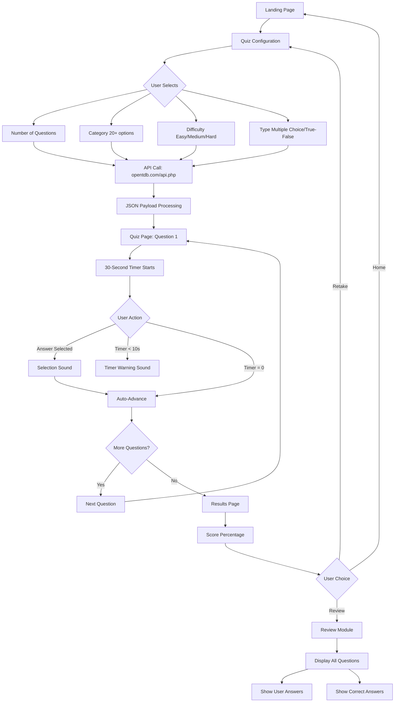

# 🎯 Dynamic Quiz Platform: Customizable Examination Engine

A modern, high-performance quiz application built with **React** and **Vite** that leverages the OpenTDB API to deliver customizable, real-time examinations across 20+ knowledge domains. Featuring automated timers, audio-tactile feedback, and comprehensive review capabilities for an enhanced learning experience.

[](https://quiz-app-tau-rose.vercel.app/)
[](https://vercel.com/)
[](https://reactjs.org/)

---

## 🎯 The "Why"

Traditional quiz applications lack customization and fail to provide meaningful feedback. **Dynamic Quiz Platform** solves this by integrating with the OpenTDB API to offer 20+ knowledge domains, 3 difficulty levels, and two question types—all with real-time state management, automated progression, and a detailed review system to reinforce learning.

---

## 🚀 Live Preview

The app is automatically deployed and hosted on **Vercel**.

**[View Live App →](https://quiz-app-tau-rose.vercel.app/)**

---

## ✨ Key Features

### 🎓 Customizable Examination Engine
* **20+ Knowledge Domains:** Generate localized tests across diverse categories including Science, History, Geography, Entertainment, Sports, and more
* **3 Difficulty Levels:** Easy, Medium, and Hard options to match user expertise
* **2 Question Types:** Multiple Choice and True/False formats
* **Dynamic Question Count:** User-selectable quiz length for flexible learning sessions
* **OpenTDB API Integration:** Real-time question fetching from the Open Trivia Database

### ⏱️ Real-Time State Synchronization System
* **30-Second Automated Timer:** Each question features a countdown timer with automatic progression
* **Zero-Latency Transitions:** Optimized state management ensures seamless navigation between quiz phases
* **Progress Tracking:** Visual indicators for current question position and completion status
* **Auto-Advance:** Automatic movement to the next question when timer expires

### 🔊 Accessible User Interface
* **Audio-Tactile Feedback:** Sound effects for timer warnings and answer selection for enhanced accessibility
* **Timer Sounds:** Audio cues to alert users of remaining time
* **Selection Sounds:** Auditory confirmation for answer choices
* **Responsive Design:** Optimized for mobile, tablet, and desktop screens

### 📊 Post-Exam Review Module
* **Detailed Score Summary:** Percentage-based results with comprehensive breakdown
* **Complete Review:** View all questions with your selected answers and correct answers side-by-side
* **Learning Feedback Loop:** Identify knowledge gaps and reinforce correct responses
* **Navigation Options:** Home, Retake Exam, and Review functionalities

### ⚡ Optimized Frontend Data Handling
* **Complex JSON Processing:** Efficient parsing and rendering of OpenTDB API payloads
* **State Management:** React state hooks for managing quiz configuration, timer, and user responses
* **Fast Performance:** Vite-powered hot module replacement (HMR) for lightning-fast development
* **Clean UI:** Minimalist and intuitive interface for better user experience

---

## 🛠️ Tech Stack

* **Library:** [React.js](https://reactjs.org/) with JavaScript
* **Build Tool:** [Vite](https://vitejs.dev/)
* **External API:** [OpenTDB (Open Trivia Database)](https://opentdb.com/)
* **Deployment:** [Vercel](https://vercel.com/)
* **Icons/Styling:** CSS3 & Lucide-react

---

## 🔄 Application Flow



---

## 📦 Installation & Local Development

To run this project locally, follow these steps:

### 1. Clone the Repository

```bash 
git clone https://github.com/sriram629/Quiz-app.git
```

### 2. Navigate to the Project Folder

```bash
cd Quiz-app
```

### 3. Install Dependencies

```bash
npm install
```

### 4. Start the Development Server

```bash 
npm run dev
```

The app will be running at **http://localhost:5173**

### 5. Build for Production

```bash
npm run build
```

---

## 📂 Repository Structure

```text
quiz-app/
├── public/                # Static assets (favicon, images)
├── src/
│   ├── assets/            # Project-specific images/icons
│   ├── components/        # Reusable UI components
│   │   ├── QuizConfig.jsx      # Configuration form
│   │   ├── Question.jsx        # Individual question display
│   │   ├── Timer.jsx           # 30-second countdown
│   │   ├── Results.jsx         # Score summary
│   │   └── Review.jsx          # Answer review module
│   ├── data/              # Quiz state management utilities
│   ├── App.jsx            # Main app logic and routing
│   ├── App.css            # Global styling
│   └── main.jsx           # Application entry point
├── .gitignore             # Files to be ignored by Git
├── index.html             # Main HTML template
├── package.json           # Project dependencies and scripts
└── vite.config.js         # Vite configuration settings
```

---

## 🎮 How to Use

### Step 1: Configure Your Quiz
1. Select the **number of questions** you want to answer
2. Choose a **category** from 20+ available options (Science, History, Sports, etc.)
3. Pick a **difficulty level**: Easy, Medium, or Hard
4. Select **question type**: Multiple Choice or True/False
5. Click **Start Quiz** to fetch questions from OpenTDB API

### Step 2: Take the Quiz
* Each question appears one at a time with a **30-second countdown timer**
* **Audio cues** provide feedback:
  - Selection sounds when you choose an answer
  - Timer warning sounds when time is running out
* Questions automatically advance when:
  - You select an answer
  - The 30-second timer expires

### Step 3: View Results
* See your **score as a percentage**
* Three navigation options:
  - **Home:** Return to configuration page
  - **Retake:** Start a new quiz with the same settings
  - **Review:** Detailed answer breakdown

### Step 4: Review Answers
* View all questions from your quiz
* See your selected answers
* Compare with correct answers
* Identify areas for improvement

---

## 📊 OpenTDB API Integration

The platform utilizes the Open Trivia Database API endpoint:

```
https://opentdb.com/api.php
```

### API Parameters
| Parameter | Options | Description |
|:---|:---|:---|
| `amount` | 1-50 | Number of questions |
| `category` | 9-32 | Category ID (20+ domains) |
| `difficulty` | easy, medium, hard | Question difficulty |
| `type` | multiple, boolean | Multiple choice or True/False |

### Sample Request
```javascript
const fetchQuestions = async (config) => {
  const response = await fetch(
    `https://opentdb.com/api.php?amount=${config.amount}&category=${config.category}&difficulty=${config.difficulty}&type=${config.type}`
  );
  const data = await response.json();
  return data.results;
};
```

---

## 🎨 Features Breakdown

### Quiz Configuration Page
* Clean form interface for quiz customization
* Real-time validation of user selections
* Immediate API integration upon submission

### Question Interface
* Single-question display for focused attention
* 30-second countdown timer with visual progress
* Answer options presented clearly
* Audio feedback for interaction

### Results Page
* Percentage-based scoring system
* Clear visual representation of performance
* Three-button navigation for user control

### Review Module
* Comprehensive answer comparison
* Color-coded correct/incorrect indicators
* Full question context for learning reinforcement

---

## 🚀 Performance Optimization

| Feature | Implementation | Benefit |
|:---|:---|:---|
| **Vite Build Tool** | ES modules + hot reload | Lightning-fast development |
| **State Management** | React hooks (useState, useEffect) | Efficient re-renders |
| **JSON Processing** | Optimized parsing logic | Zero-latency transitions |
| **API Integration** | Async/await with error handling | Reliable data fetching |
| **Timer System** | setInterval with cleanup | Precise 30-second countdown |

---

## 🎓 Available Quiz Categories

The OpenTDB API provides 20+ categories including:
- General Knowledge
- Science (Computers, Mathematics, Nature)
- Entertainment (Books, Film, Music, TV)
- Sports
- Geography
- History
- Art
- Celebrities
- Animals
- Vehicles
- And many more...

---

## 📸 Application Gallery

<details>
<summary>Click to view all screenshots</summary>

| Landing Page | Quiz Interface |
| :---: | :---: |
|  |  |

| Score Summary | Review Quiz |
| :---: | :---: |
|  |  |

</details>

---

## 🎯 Use Cases

### For Students
* Prepare for exams across multiple subjects
* Practice time management with 30-second timers
* Review mistakes to improve knowledge retention

### For Educators
* Quick knowledge assessments
* Supplementary learning tool
* Gamified learning experience

### For Casual Learners
* Test general knowledge
* Explore new topics across 20+ domains
* Challenge friends with customized quizzes

---

## 🔮 Future Enhancements

- [ ] User authentication and score history
- [ ] Leaderboard system
- [ ] Custom quiz creation
- [ ] Social sharing of results
- [ ] Offline mode support
- [ ] Advanced analytics dashboard

---

## 🤝 Contributing

Contributions are welcome! Please feel free to submit a Pull Request.

---

## 📝 License

This project is open source and available under the MIT License.

---

## 🔗 Links

- **Live Demo:** [quiz-app-tau-rose.vercel.app](https://quiz-app-tau-rose.vercel.app/)
- **OpenTDB API:** [opentdb.com](https://opentdb.com/)
- **Report Issues:** [GitHub Issues](https://github.com/sriram629/Quiz-app/issues)

---

## 🙏 Acknowledgments

- [Open Trivia Database (OpenTDB)](https://opentdb.com/) for providing the free quiz API
- [Vercel](https://vercel.com/) for seamless deployment
- [React](https://reactjs.org/) and [Vite](https://vitejs.dev/) teams for excellent tools

---

**Built with ❤️ using React, JavaScript, and the OpenTDB API**
